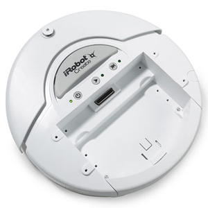

<p align="center">
    
</p>

# iRobot-Create

[](https://github.com/alexsigaras/iRobot-Create) 
[](https://opensource.org/licenses/MIT)

This project provides a C# library for controlling the iRobot Create platform. It enables communication and control of the iRobot Create robot through a serial port connection.

## Project Structure
The solution consists of two main projects:

1. iRobotCreate.Library: The core library that handles communication with the iRobot Create
    - Contains classes for robot control, sensor data handling, and unit conversions.
2. iRobotCreate.Test.WPF: A WPF application for testing the library functionality
    - Provides a graphical interface for interacting with the robot.
    
## Features
- Serial port communication with the iRobot Create
- Robot movement control (forward, backward, rotation)
- Sensor data retrieval (bumps, wheel drops, wall detection, battery status)
- Automatic obstacle avoidance behavior
- Power control for auxiliary devices (like Kinect)
- Support for both streaming and query-based sensor data retrieval

## Key Classes
- **iRobot**: Main class for controlling the robot
- **Sensors**: Handles sensor data processing
- **Units**: Provides unit conversion structures like Velocity and Radius
Getting Started
Reference the iRobotCreate.Library in your project
Create an instance of the iRobot class
Connect to your robot using the Connect method with the appropriate COM port
Control the robot using the provided movement methods

## Example Usage

```csharp
// Create a new robot instance
iRobot robot = new iRobot();

// Connect to the robot on COM3
if(robot.Connect("COM3"))
{
    // Move forward at 200 mm/s
    robot.move(200, 0);
    
    // Wait for 2 seconds
    System.Threading.Thread.Sleep(2000);
    
    // Stop the robot
    robot.moveStop();
}
```


## Contributing

Contributions are welcome! Please feel free to submit a Pull Request.

## License

Copyright (c) Alexandros Sigaras. All rights reserved.

Licensed under the [MIT](LICENSE) License.